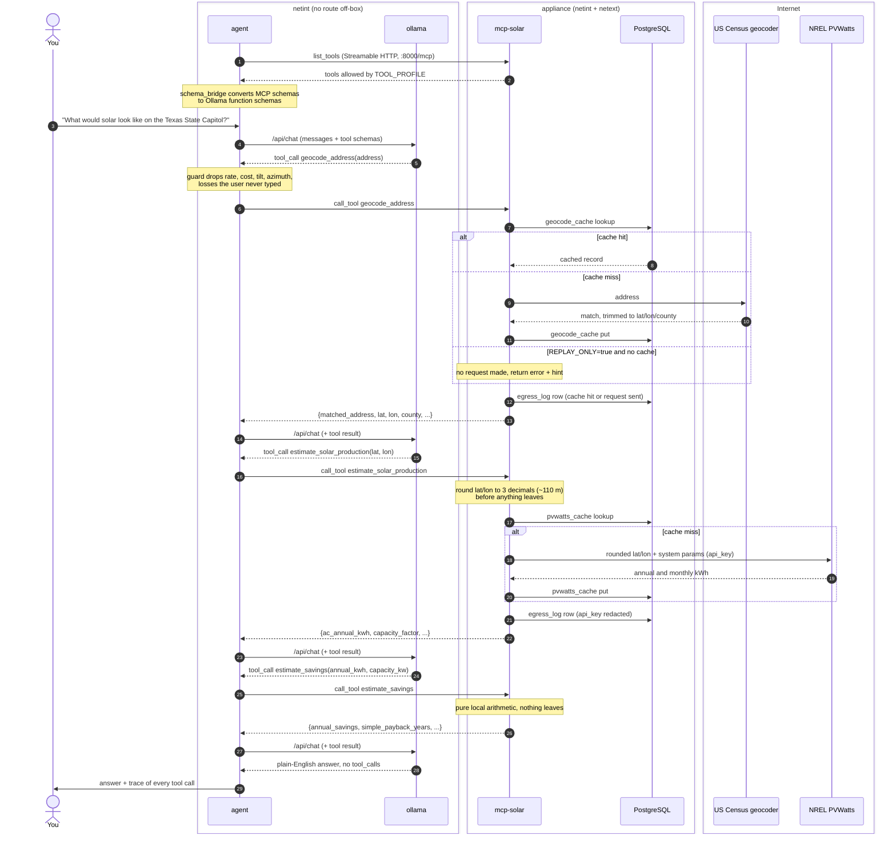

# localaimcp — a local AI agent that evaluates solar potential

Ask *"is my house good for solar?"* and get a real answer, grounded in real
data, from a model running on your own hardware.

The reasoning never leaves your machine. The container running the LLM has **no
route to the internet** — not by policy, but by network topology. Exactly two
requests leave the box per uncached assessment, both to US government APIs, and
the stack prints you a receipt for them.

```
you › What would solar look like on the Texas State Capitol?

  → geocode_address(address="Texas State Capitol, Austin TX")
  ← {"matched_address": "1100 CONGRESS AVE, AUSTIN, TX, 78701", "county": "Travis County", …} [486 ms]
  → estimate_solar_production(lat=30.276, lon=-97.74)
  ← {"ac_annual_kwh": 11482.3, "capacity_factor": 18.7, …} [512 ms]
  → estimate_savings(annual_kwh=11482.3, capacity_kw=7.0)
  ← {"annual_savings": 1722.35, "simple_payback_years": 11.4, …} [1 ms]

A 7 kW array there would make about 11,500 kWh a year — roughly $1,720 at
15¢/kWh, paying back its ~$19,600 cost in about eleven years (the residential
federal tax credit ended for systems installed after 2025).
```

## Requirements

- **Podman** 5+ (rootless). No Docker, no Kubernetes, no cloud account.
- A compose provider: `podman-compose` is recommended (see Troubleshooting).
- ~8 GB RAM available to containers, ~15 GB disk.
- A free [NLR (formerly NREL) API key](https://developer.nlr.gov/signup/).

Works on Linux, macOS and Windows — everything, including systemd, runs inside
containers.

## Quick start

```bash
cp .env.example .env         # then paste your NLR key into it
make doctor                  # checks podman, cgroups, memory, disk
make setup                   # builds images, pulls the model (~4.7 GB, once)
make up                      # starts the stack
make demo                    # talk to it
```

## What is actually running

```
netint (internal: true — no route off-box)
  ├── ollama       the model. Cannot reach the internet.
  ├── agent        the tool-calling loop. Also cannot reach the internet.
  └── appliance ───┐  systemd PID 1 supervising:
                   │    postgresql.service
netext (bridge)  ──┘    migrate.service    (oneshot, before the server)
  only the appliance    mcp-solar.service  (Streamable HTTP on :8000/mcp)
```

The appliance is the only container attached to both networks, so it is the
only possible egress path. That is enforced by the kernel, not by our code.

### One question, end to end



With `TOOL_PROFILE=composite` the model makes a single `assess_property` call
instead, and `mcp-solar` runs geocode, production and savings itself and then
saves the result to the `assessments` table. The agent stops after 6 tool
rounds if the model never produces a final answer.

### Prove it yourself

```bash
make prove-isolation   # topology: which container is on which network
make prove-egress      # identical probe from two containers, two outcomes
make egress-report     # every byte that left, this session
```

`prove-isolation` works with the network unplugged; `prove-egress` needs a
working connection to be meaningful.

## The MCP server

`mcp-solar` speaks **Streamable HTTP**, so it is a real network service that any
MCP client can use — not just the agent in this repo. It is published on
`127.0.0.1:8000` only: it has no authentication, so it is not exposed to your
LAN.

| Tool | What it does | Leaves the machine? |
|---|---|---|
| `geocode_address` | address → lat/lon, county | US Census (cached) |
| `estimate_solar_production` | lat/lon → annual & monthly kWh | NREL PVWatts (cached) |
| `estimate_savings` | kWh → dollars, payback | **no** |
| `save_assessment` / `list_assessments` | local Postgres | **no** |
| `assess_property` | all of the above in one call | Census + NREL |

It also exposes an MCP **resource** (`solar://assessments/recent`) and a
**prompt** (`solar_assessment`) — the server ships the prompt engineering, not
just the functions.

### Adding your own tool

Drop one file in `src/mcp_solar/tools/`:

```python
from . import tool

@tool(profiles=("granular", "all"))
async def roof_area_to_capacity(square_feet: float) -> dict:
    """Estimate installable system size from usable roof area."""
    return {"capacity_kw": round(square_feet / 100.0, 2)}
```

It is auto-discovered at startup. That is the whole registration step.

### Tool errors are prompts

Tools never raise across the MCP boundary. They return `{"error": …, "hint": …}`
where `hint` is written *for the model*:

```json
{"error": "no match for '123 Nowhere'", "hint": "Ask the user for the city, state and ZIP, then try again."}
```

## Privacy, stated precisely

We do **not** claim zero network. We claim minimal, auditable, non-identifying
egress:

- The model has no route to the internet. Neither does the agent.
- Per uncached assessment, two requests leave: an address to the US Census
  geocoder, and a **rounded** coordinate (3 decimals, ~110 m) to NREL PVWatts.
- No API key identifies you to Census. Secrets are redacted before logging.
- No prompt, conversation, reasoning or stored result is ever transmitted.
- Cached answers leave nothing at all.

Want true zero? Swap the Census geocoder for a local Nominatim with a Texas OSM
extract; `geocode.py` is the only file that changes. It costs ~4 GB and a
~30 minute import, which is why it is not the default.

## systemd, inside the container

Podman runs systemd as PID 1 rootless and unprivileged — no `--privileged`, no
cgroup hacks:

```bash
make systemd-status    # units and the dependency graph
podman exec appliance systemctl list-dependencies mcp-solar.service
podman exec appliance systemctl restart mcp-solar.service
```

This is why the stack behaves identically on macOS, Windows and Linux: the
systemd lives in the container's Linux userspace. On a Linux host you can
*additionally* use the Quadlet units in `quadlet/` to have the host's systemd
supervise the containers themselves.

> `warm-cache.timer` is shipped **masked** (`systemctl mask` in the image). It
> makes outbound requests, and a timer firing mid-demo would quietly add rows to
> the egress log. `make demo` warns if it is anything other than masked.

## Configuration

See `.env.example`. Both `podman compose` and the Makefile read `.env`; a
variable set in your shell overrides it for one command. The ones that matter:

| Variable | Default | Why you'd change it |
|---|---|---|
| `MODEL_NAME` | `qwen2.5:7b-instruct` | `qwen2.5:3b-instruct` is 3–4× faster on CPU |
| `TOOL_PROFILE` | `all` | `granular` hides the composite tool; `composite` hides the chain. **Server-side:** `TOOL_PROFILE=granular make up` |
| `REPLAY_ONLY` | `false` | `true` = never touch the network; cache or fail. **Server-side:** `REPLAY_ONLY=true make up` |
| `OLLAMA_KEEP_ALIVE` | `-1` | Keep the model resident; avoids a 6–8 s cold load per turn |
| `OLLAMA_NUM_CTX` | `8192` | Ollama's 4096 default silently truncates tool results |

## Running offline

```bash
make seed-cache                 # load committed fixtures
REPLAY_ONLY=true make up        # the MCP server enforces it, so set it here
make demo                       # cache miss becomes an error, never a request
```

## Troubleshooting

**`docker-credential-desktop: executable file not found`** — Podman picked
Docker Desktop's compose binary. Install `podman-compose` and tell Podman to
prefer it:

```bash
brew install podman-compose
printf '[engine]\ncompose_providers=["podman-compose"]\n' >> ~/.config/containers/containers.conf
```

**Everything is glacial, or the model gets OOM-killed** — the podman VM is
probably too small. Give it real resources:

```bash
podman machine stop
podman machine set --cpus 8 --memory 8192 --disk-size 40
podman machine start
```

**`Invalid Host header`** — the MCP server has DNS-rebinding protection on. Add
your hostname to `MCP_ALLOWED_HOSTS` (comma-separated).

**SELinux on Fedora** — bind mounts need `:Z`.

## Development

```bash
python3 -m venv .venv && .venv/bin/pip install -r requirements-dev.txt
make test                  # offline; no network, no database
ln -sf ../../scripts/pre-commit .git/hooks/pre-commit
```

The pre-commit hook refuses to commit `.env`, egress-log dumps, or any address
not on the public-landmark allowlist in `fixtures/seed_addresses.txt`.

## License

Apache-2.0
